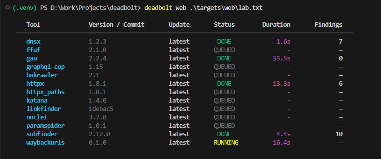
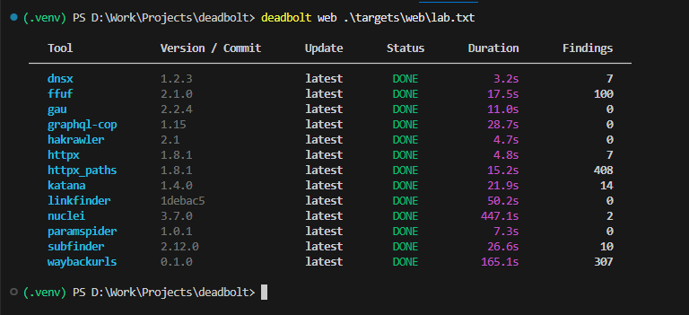
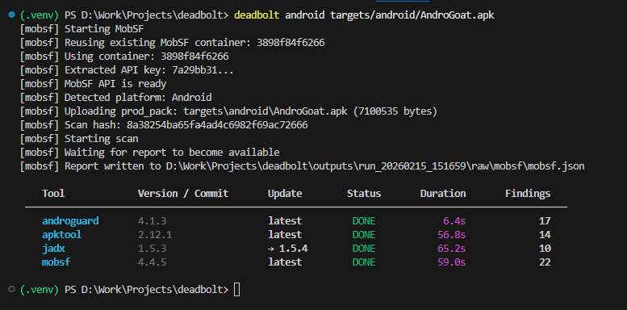
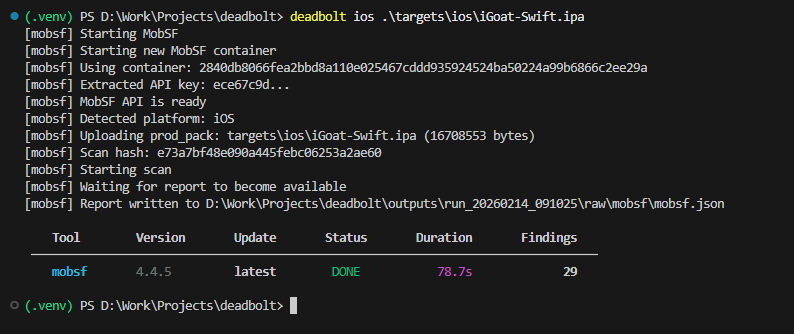
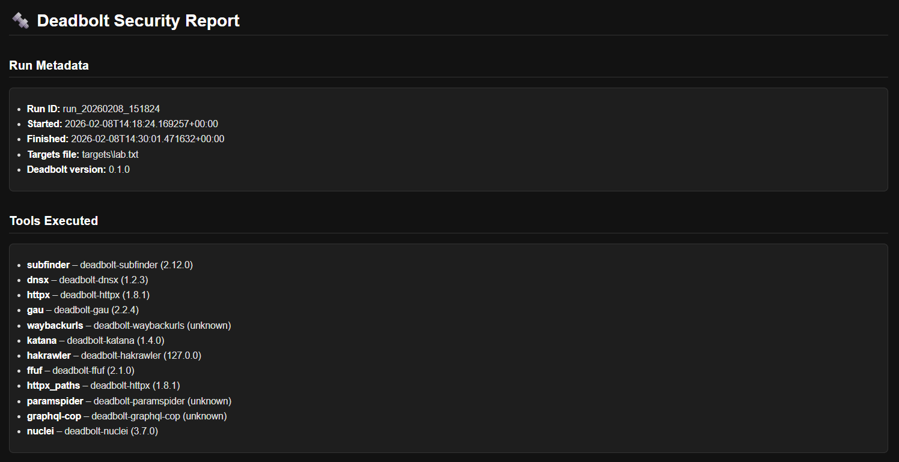
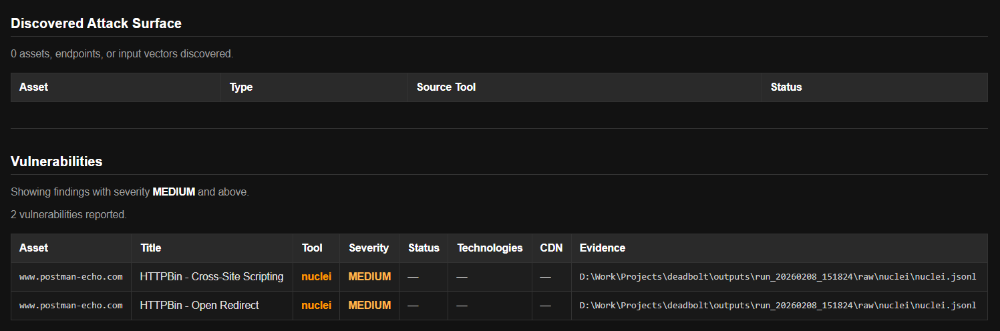
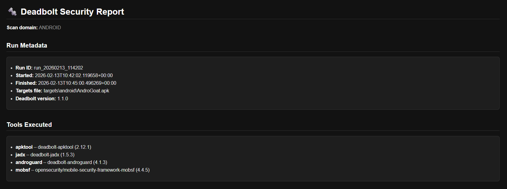
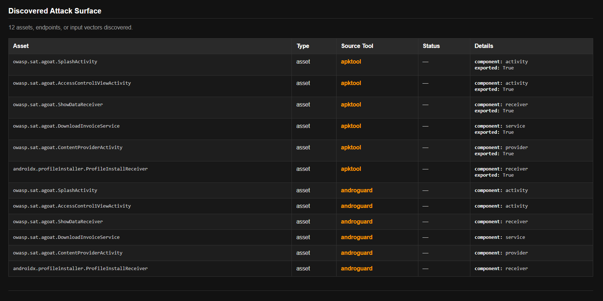
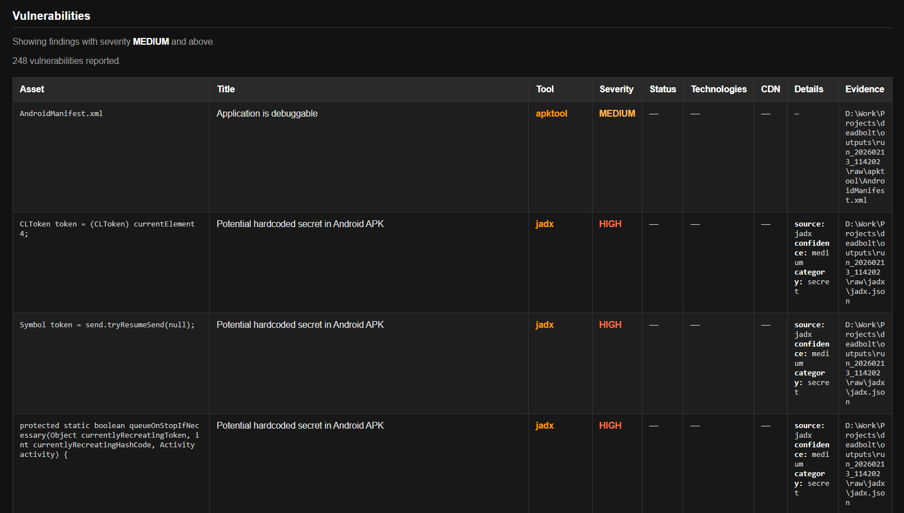

# 🔩 Deadbolt

**Deadbolt** is a lean, professional pentest orchestrator for **AppSec engineers** and **security teams**.

It does not guess.  
It does not over-scan.  
It verifies whether the lock actually holds.

Deadbolt is built for **controlled, auditable reconnaissance and security assessment**, not noisy automation or blind scanning.




















## What Deadbolt is (and isn’t)

### Deadbolt **is**

- A **tool orchestrator**, not a monolithic scanner
- Deterministic, resumable, and auditable
- Designed for real-world AppSec and pentest workflows
- Explicit about **data flow** and **tool responsibility**
- Focused on explaining *why* something was found

### Deadbolt is **not**

- A “click-run-everything” scanner
- A brute-force automation framework
- A replacement for human reasoning or validation


## Core capabilities

- Containerized execution (Docker, fully isolated per tool)
- **Hard scope enforcement** (runs refuse to start if scope is violated)
- Deterministic, phase-based pipelines
- Explicit artifact flow between tools
- Resume-safe execution using content hashing
- Live execution visibility (Rich execution table)
- Raw evidence preserved per tool
- Normalized findings schema
- Auditable run metadata (`meta.json`)
- Tool version detection and update awareness
- HTML report generation
- Multi-domain support:
  - 🌐 Web
  - 🖧 Network
  - 🤖 Android (APK)
  - 🍎 iOS (IPA)

## Execution model

### Web pipeline

```
Discovery → Enumeration → Vulnerability
```

Artifacts flow explicitly:

```
targets → assets → paths → findings
```

### Mobile pipelines

- **Android**: Static analysis (apktool, androguard, jadx, MobSF)
- **iOS**: Static analysis (MobSF)

### Network pipeline

```text
Authorization → Plan → Discovery → Service evidence → Validation → Reporting
```

Network execution is engagement-bound and preserves the exact Nmap plan,
phase state, raw XML, normalized inventory, scope validation, and reports.

Each tool:

- Declares what it consumes
- Declares what it produces
- Runs in isolation
- Emits normalized findings

Tool lifecycle metadata is defined centrally in `main/config/tools.yaml`.
This manifest is the source of truth for scanner images, expected versions,
upstream repositories, domains, Dockerfiles, and version-detection behavior.

Inspect local tool versions and upstream update availability:

```bash
deadbolt tools status
deadbolt tools status --offline
deadbolt tools status --offline --domain web
deadbolt tools status --json
```

Check Docker, required images, scope, wordlists, report assets, targets, and
MobSF port readiness:

```bash
deadbolt tools doctor
deadbolt tools doctor --json
deadbolt tools providers
```

Provider diagnostics show only configured and missing variable names; secret
values from the environment or `.env` are never printed.

Build the exact manifest pins, create versioned and `current` aliases, and
verify every resulting image:

```bash
deadbolt tools build
deadbolt tools build --outdated
deadbolt tools build --tool httpx --tool nuclei
deadbolt tools build --domain web --parallel 3
deadbolt tools build --domain android --no-cache --pull
deadbolt tools build --outdated --json
```

`--outdated` repairs local drift only (missing, mismatched, or unverifiable
images). A newer upstream release shown by `tools status` is not installed
until its manifest pin is deliberately updated and tested.

Use the guarded upgrade workflow for newer upstream releases:

```bash
# Read-only upgrade plan
deadbolt tools upgrade plan

# Build and verify an isolated candidate; active images remain unchanged
deadbolt tools upgrade test --tool httpx

# Promote only after reviewing the successful candidate result
deadbolt tools upgrade promote --tool httpx

# Verify the promoted environment
deadbolt tools status --offline
deadbolt tools doctor

# Restore the prior pin and image if necessary
deadbolt tools upgrade rollback --tool httpx
```

Managed candidates use a `candidate-<version>` tag. Promotion first preserves
the active image under `rollback-<old-version>`, rechecks the candidate, updates
the runtime aliases, and then changes the manifest. Candidate and rollback
records live under the ignored local `.deadbolt/` directory.

## Supported tooling

### Web — Discovery

- **subfinder** – subdomain discovery  
- **dnsx** – DNS resolution  
- **naabu** – TCP service discovery
- **tlsx** – TLS certificate and protocol inventory
- **httpx** – HTTP(S) validation & classification  

### Web — Enumeration

- **gau** – historical URL discovery  
- **waybackurls** – archive-based endpoint recovery  
- **katana** – crawler-based surface expansion  
- **hakrawler** – HTML link extraction  
- **linkfinder** – endpoint discovery in JavaScript files
- **ffuf** – endpoint discovery via fuzzing  
- **httpx (paths mode)** – path validation & enrichment  

### Web — Input & API

- **paramspider** – parameter discovery  
- **arjun** – active HTTP parameter discovery
- **graphql-cop** – GraphQL endpoint analysis  

### Web — Vulnerability

- **nuclei** – template-based vulnerability detection  

### Network

- **nmap** – bounded host, port, service, OS, and curated evidence collection

### Mobile

- **apktool** – Android resource and manifest decoding for declared attack surface and configuration analysis  
- **androguard** – Semantic Android analysis (permissions, signing, exported components, application flags)  
- **jadx** – Dalvik bytecode decompilation for code-level inspection and hardcoded secret discovery  
- **MobSF** – Correlated Android & iOS security analysis combining manifest, code, crypto, and network signals

## Requirements

- Python **3.10+**
- Docker Desktop (WSL2 recommended on Windows)
- Git

## Clone the repository

```bash
git clone https://github.com/rdSoftInc/deadbolt.git
cd deadbolt
```

## Python environment

```bash
python -m venv .venv
source .venv/bin/activate
```

Install Deadbolt:

```bash
python -m pip install --upgrade pip
python -m pip install -e .
```

Run Guided Mode from the repository workspace:

```bash
deadbolt
```

Direct subcommands remain available for repeatable automation; Guided Mode
teaches the equivalent command before an assessment or state-changing action.

## Build scanner images (required)

Deadbolt executes each tool inside an isolated Docker container. Build the
manifest pins once before scanning:

```bash
deadbolt tools build --parallel 3
deadbolt tools doctor
```

## MobSF setup (manual, one-time)

Deadbolt uses the **official MobSF Docker image** for Android and iOS analysis.
This image is **not built locally**. `deadbolt tools build` pulls its exact
manifest tag automatically. To pull it alone:

### Pull MobSF image

```bash
deadbolt tools build --tool mobsf
```

Verify image is available

```bash
docker images opensecurity/mobile-security-framework-mobsf:v4.5.2
```

Deadbolt will automatically:

- Start the MobSF container when required
- Reuse an existing running MobSF container if present
- Extract the MobSF API key from container logs
- Wait for the MobSF API to become ready before scanning

No additional MobSF configuration is required beyond pulling the image.

## Targets & scope

### Scope configuration (mandatory)

Define scope in `scope.yaml`:

```yaml
allow:
  - example.com
  - postman-echo.com

deny:
  - google.com
```

Runs **fail fast** if scope is violated.
An empty allowlist authorizes nothing: legacy Web scope is fail-closed and
requires at least one explicit hostname or explicit `*.example.com` wildcard.

## Engagement files

Deadbolt has a versioned engagement model for bug-bounty, client, internal,
and lab work. It records the authorization boundary separately from any one
scanner:

- Safe, Standard, or Deep operating mode
- Allowed and denied hostnames or CIDR networks
- Allowed and denied ports
- Excluded URL paths
- Whether automation is permitted
- An optional request-rate ceiling
- Required user agent and identifying request headers

See `engagements/example.yaml` for the schema. Real engagement files under
`engagements/` are ignored by Git because they can contain confidential client
scope or identifying header values. Deadbolt saves generated engagement files
with owner-only permissions (`0600`).

Guided Mode provides **Engagements and scope** from the main menu. From there
you can create an engagement, open and review a redacted policy summary, edit
it, validate saved files and permissions, review `scope.yaml`, or start a
supported assessment. New and edited engagement drafts are reviewed before
they are saved. Web launches use an immutable generated
scope file derived from the selected engagement and inherit its assessment
mode. Deadbolt blocks launch when the engagement prohibits automation or uses
a traffic/header/path/port rule that the current scanner adapters cannot yet
enforce consistently. Existing `scope.yaml` scans remain fully compatible.

The main **Start an assessment** menu also exposes Web, Network, Android, and
iOS directly. Web can use a saved engagement or the workspace `scope.yaml`;
Network requires a saved engagement and offers to create the first one in place.

## Running scans

### Before a real bug-bounty assessment

Do not begin from the legacy workspace scope or assume that a program permits
automation. Use this sequence for each program:

1. Read the current program rules and record the allowed hosts, explicit
   wildcard scope, exclusions, automation permission, rate ceiling, and any
   required identifying headers.
2. Run `deadbolt`, choose **Engagements and scope → Create engagement**, and
   select **Safe** unless the written rules explicitly permit a stronger mode.
3. Review the redacted draft and its **Web readiness** result. Deadbolt blocks
   Web launch when a required header, user agent, path exclusion, port rule, or
   unsupported rate ceiling cannot be enforced consistently by every adapter.
4. Choose **Validate saved engagements**, then run `deadbolt tools doctor` and
   `deadbolt tools status` before sending traffic.
5. Start from the saved engagement, review the exact execution preview, and
   confirm that every target is an authorized program asset.
6. Review `work/rejected-scope.txt`, scanner errors, coverage limitations, raw
   evidence, and the technical report. Reproduce suspected vulnerabilities
   manually before submitting them.

An all-green tool status means the installation is ready; it does not grant
authorization and does not prove that automation is allowed by a program.

### Web

```bash
deadbolt web targets/web/lab.txt
deadbolt web targets/web/lab.txt --profile safe
deadbolt web targets/web/program.txt --profile safe --browser-assisted --rate-limit 5
deadbolt web targets/web/lab.txt --profile deep
```

Web profiles control the complete scan policy without changing authorization scope:

- `safe` — low-rate assessment for bug-bounty and sensitive production targets; port scanning, brute forcing, DAST, and OAST are disabled.
- `standard` — balanced JavaScript crawling and validation; the daily-driver default.
- `deep` — all TCP ports, Chromium-backed XHR/form extraction, resilient timeouts, and active Nuclei DAST fuzzing for labs or explicitly authorized engagements.

`--browser-assisted` is independent of Deep mode. With `--profile safe`, it
launches a bounded Chromium crawl to observe Fetch/XHR traffic while keeping
port scanning, brute force, DAST, and OAST disabled. `--rate-limit` applies an
engagement ceiling to rate-aware scanners and serializes enumeration producers
to avoid multiplying the configured rate through parallel tool execution. The
guided bug-bounty workflow offers this choice and inherits the saved engagement
rate ceiling automatically.

Web coverage also includes Naabu service discovery, structured A/AAAA/CNAME
evidence, TLSx certificate/protocol inventory, Arjun parameter discovery, and
Nuclei/Interactsh out-of-band testing. Discovered services are passed through
HTTPx before endpoint enumeration and vulnerability analysis.

JavaScript endpoint discovery retains the bundle URL, raw extracted expression,
resolved URL, and all duplicate discovery contexts in the API inventory.
LinkFinder does not expose source offsets, so plain string discoveries leave
source locations unknown; Deadbolt's static reconstructor records line-level
locations for expressions it understands. Cross-origin endpoints
are retained as evidence and classified against scope; unknown or out-of-scope
hosts are never promoted into active scanner worklists.

Deadbolt also performs conservative, non-executing reconstruction of direct
`fetch`, Axios verb-helper, and `XMLHttpRequest.open` calls. Deterministic
constants, concatenations, template strings, object properties, and
location-derived origins can produce `INFERRED / MEDIUM` API operations with
HTTP methods and request-body field names. Runtime-dependent expressions remain
unresolved, and inferred-only URLs are evidence for review rather than new
active-probe targets.

Simple named functions and block-bodied arrow functions that directly wrap
Fetch or Axios are analyzed at their call sites. When the wrapper contract is
deterministic, Deadbolt propagates its fixed or caller-supplied HTTP method,
JSON body field names, static request-header names, credentials mode, and
wrapper chain. Header and body values are never retained. Dynamic dispatch,
computed configuration, and runtime-selected methods remain unknown.

For directly chained promise responses, Deadbolt can retain response field
names. Nearby required, length, pattern, and type checks are recorded only for
fields already proven to enter that request body. These are reconnaissance
notes about client behavior, not server-side guarantees or vulnerabilities.

Deep profile's headless Katana session also produces a report-safe browser
request ledger at `work/enumeration.browser-requests.json`. Fetch/XHR methods,
normalized URLs, query-parameter names, response status/content type, scope,
and provenance are retained when Katana exposes them. Response header names,
explicit API-version indicators, and infrastructure cookie names are retained
without their sensitive values. CORS `OPTIONS` requests
are stored separately and associated with the application operation instead
of being counted as another API. Cookies, header values, and bodies are omitted.

The technical API inventory is sorted into an explainable manual-testing
handoff. Deadbolt classifies likely endpoint purpose (for example
authentication, OAuth/OIDC, object access, file handling, configuration, or
health/status) and maps security-relevant parameter names to applicable review
families such as IDOR/BOLA, path traversal, SSRF, and open redirect. These are
review suggestions only, never vulnerability findings. Unknown and out-of-scope
origins are always kept at low priority and remain evidence-only.
HTTPx technology enrichment is separated into application and infrastructure
layers; framework clues such as Problem Details responses are labelled as
heuristics, not treated as proof.

### Network workflow foundation

Network assessments require a saved engagement because IP and CIDR scanning
must never inherit the hostname-only legacy scope implicitly. The command
validates and snapshots authorization before executing the selected policy:

```bash
deadbolt network targets/network/internal.txt \
  --engagement engagements/internal.yaml \
  --mode standard
```

Use `--plan-only` to validate and persist the exact plan without sending packets:

```bash
deadbolt network targets/network/internal.txt \
  --engagement engagements/internal.yaml \
  --mode safe \
  --plan-only
```

Network target files accept one IPv4 address, IPv6 address, CIDR, or hostname
per line. URLs, host:port values, and malformed names are rejected. Every IP
range must be wholly contained by an allowed engagement network and must not
overlap a denied range. Hostnames use the same exact/explicit-wildcard rules as
web scope.

The run records canonical targets, the non-expanded unique address
count, mode, engagement hash, an owner-only engagement snapshot, and the exact
scope-bound Nmap plan. Guided Mode previews its phases, port policy, and rate
ceiling before its authorization and start confirmations.

Network modes currently compile to these bounded policies:

- `safe` — TCP connect scan of the top 100 ports, `-T2`, maximum 10 packets/second.
- `standard` — TCP connect scan of the top 1000 ports, light service detection,
  curated evidence scripts, `-T3`, maximum 100 packets/second.
- `deep` — full TCP SYN/service/OS detection plus a top-100 UDP phase and a
  broader evidence-script allowlist, maximum 500 packets/second.

An engagement's lower rate ceiling always wins. Explicit allowed ports replace
the profile defaults, denied ports are excluded, and a narrow allowed-port list
forces `-Pn` so Nmap cannot issue implicit discovery probes to undeclared TCP
ports. Safe mode runs no NSE scripts. Standard permits only `banner`,
`http-title`, `ssl-cert`, and `ssh-hostkey` with a 30-second script timeout.
Deep additionally permits `http-headers`, `http-methods`,
`smb2-security-mode`, and `smb2-time` with a 60-second timeout. Vulnerability,
intrusive, brute-force, and denial-of-service script categories are not enabled.

Each phase runs sequentially from the immutable versioned image with a
read-only container filesystem, all Linux capabilities dropped, and
`no-new-privileges`. Safe and Standard explicitly use Nmap's unprivileged mode;
Deep receives only `NET_RAW` and `NET_ADMIN`. XML and combined logs are written
under `raw/` and `logs/`, while atomic phase state records durations, exit
codes, timeouts, and output hashes. Ctrl+C stops the active container and marks
the run resumable. Resume verifies the original plan and output hashes, restores
completed phases, and runs only unfinished work. Explicit IPv4 and IPv6 inputs
are split into correct Nmap invocations. Hostnames are scanned once through
Nmap's normal address resolution; include an explicit IPv6 literal or CIDR when
IPv6 coverage is required.

Nmap is managed as a pinned network scanner through the standard tool lifecycle:

```bash
deadbolt tools status
deadbolt tools build --tool nmap
deadbolt tools upgrade plan --tool nmap
```

Deadbolt builds the official Nmap source release after validating its published
SHA-256 digest. Successful network collection is normalized into:

- `normalized/network-inventory.json` — hosts, addresses, hostnames, ports,
  services, products, versions, CPEs, OS candidates, scripts, and exposure-review items.
- `normalized/findings.json` — canonical host/service assets plus explicit
  vulnerability results.
- `normalized/network-findings.json` — vulnerability signals only.
- `normalized/network-quality.json` — post-scan scope verification, evidence
  quality grade, identification ratios, and actionable coverage warnings.
- `technical-report.html` — complete inventory, execution, evidence, and limitations.
- `stakeholder-report.html` — concise reach, risk signals, review priorities, and next actions.

Open ports are never presented as vulnerabilities by themselves. Administrative,
legacy, and cleartext services enter an exposure-review queue, while a security
finding requires explicit vulnerable scanner evidence and remains unverified
until reproduced by an analyst. Raw XML is retained and every normalized output
is hashed in run state for traceability.

Post-scan validation independently checks that every returned service belongs
to the effective allowed-port set and is not denied. A mismatch stops report
finalization with `processing_failed`. Evidence receives a `complete`, `partial`,
or `limited` quality grade based on phase/XML consistency, scanner exit records,
host visibility, service identification, and expected Deep-mode OS evidence.
When Nmap leaves a low-confidence port-table label but records an unambiguous
HTTP response in its fingerprint evidence, Deadbolt reports `http` as
`fingerprint-inferred` while preserving the original table guess and raw output.

Recommended daily workflow:

```bash
# 1. Review health and exact scanner versions
deadbolt tools doctor
deadbolt tools status

# 2. Validate scope and inspect the immutable plan without traffic
deadbolt network targets/network/internal.txt \
  --engagement engagements/internal.yaml \
  --mode safe \
  --plan-only

# 3. Run only after reviewing the plan and written authorization
deadbolt network targets/network/internal.txt \
  --engagement engagements/internal.yaml \
  --mode safe

# 4. Resume a failed or interrupted run without repeating verified phases
deadbolt network outputs/RUN_ID/work/input.network-targets.txt \
  --engagement engagements/internal.yaml \
  --resume-from outputs/RUN_ID
```

The same workflow is available interactively under **Engagements and scope →
Open an engagement → Start assessment → Network**. Guided Mode provides
separate **Run new assessment**, **Review and save plan only**, and **Resume
assessment** actions. It identifies the profile as inherited from the
engagement and prints both report paths after successful completion.

### Optional provider credentials

Copy `.env.example` to `.env` and fill only the providers you use. The local
file is ignored by Git and credential values are never written to reports.

```bash
cp .env.example .env
deadbolt tools doctor
```

Provider credential slots currently include Shodan, Censys, SecurityTrails,
VirusTotal, Chaos, ProjectDiscovery, and private Interactsh. Private Interactsh
configuration is consumed by the Nuclei adapter today. The other entries are
readiness placeholders for future provider adapters and do not add scan
coverage merely by setting a key. Doctor displays only variable names and
configuration state; it never prints values.

Deep mode is intentionally opt-in because browser execution consumes more time
and memory. Its browser-observed methods and API endpoints are written to
`work/enumeration.api-inventory.json` and included in the technical report.
The inventory uses a versioned canonical evidence schema that distinguishes
observed, inferred, and string-discovered operations. It records confidence,
scope status, provenance, content types, wrapper chains, and manual-review
metadata. Value-free request schemas retain method-bound query, path, and body
field names plus conservative structural types. Browser-observed operations are
authoritative; static reconstruction may enrich missing structure, while
method or schema disagreements remain visible as reconciliation conflicts.
Cookies, tokens, header values, and request/response field values are never
retained. Older list-shaped inventory files remain readable when historical
runs are reopened.

### Local web lab (Docker Desktop)

Deadbolt accepts the browser-facing loopback URL and preserves non-standard
ports. It maps `localhost` to Docker's host gateway only inside scanner inputs.

```bash
printf 'http://localhost:3000/#/\n' > targets/web/juice-shop.txt
deadbolt web targets/web/juice-shop.txt --local-lab --profile deep
```

Local-lab targets must use `http://` or `https://` and resolve to localhost or
a loopback IP. Browser fragments are removed because they are not sent to the
server. Public DNS and archive reconnaissance is marked not applicable; HTTP
validation, crawling, fuzzing, endpoint analysis and vulnerability scanning
remain enabled. The effective local authorization boundary is snapshotted in
the run directory. Before a scan starts, Deadbolt verifies that the target is
reachable from both the host and Docker network.

### Android

```bash
deadbolt android targets/android/AndroGoat.apk
```

### iOS

```bash
deadbolt ios targets/ios/app.ipa
```

### Docker image cleanup

Preview obsolete Deadbolt-managed image references without changing Docker:

```bash
deadbolt tools cleanup
```

Apply exactly the displayed plan:

```bash
deadbolt tools cleanup --apply
```

Cleanup preserves active images, verified upgrade candidates and the recorded
rollback image. It does not run a global Docker prune and never removes
unrelated images. Unlabelled legacy dangling images are reported but left
untouched because Deadbolt cannot prove ownership.

Generated reports can be reopened or refreshed from preserved run evidence:

```bash
deadbolt reports open outputs/run_YYYYMMDD_HHMMSS --audience technical
deadbolt reports open outputs/run_YYYYMMDD_HHMMSS --audience stakeholder
deadbolt reports generate outputs/run_YYYYMMDD_HHMMSS
```

Regeneration requires `meta.json` and `normalized/findings.json` and updates
both audience reports using the current Deadbolt templates.

## Output structure

```text
outputs/run_YYYYMMDD_HHMMSS/
├─ meta.json
├─ state.json
├─ report.html                 # compatibility alias for the technical report
├─ technical-report.html       # evidence, coverage, tools, and scope detail
├─ stakeholder-report.html     # concise risk and decision-maker summary
├─ raw/
├─ work/
└─ normalized/
```

## Philosophy

Deadbolt prioritizes:

- Correctness
- Control
- Auditability

Every result is traceable to its origin.


## License

Deadbolt is released under the **MIT License**.

© 2026 Rolstan Robert D'souza
