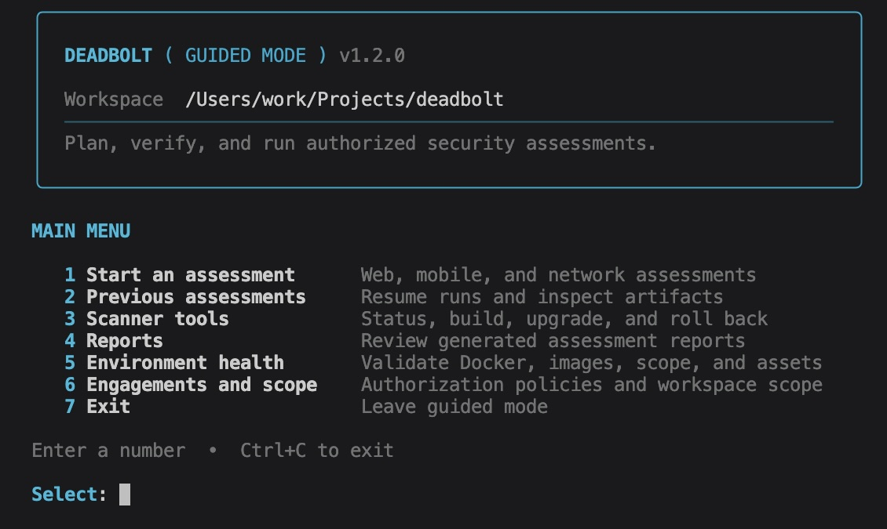
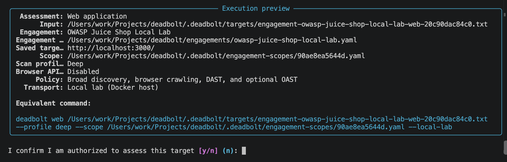
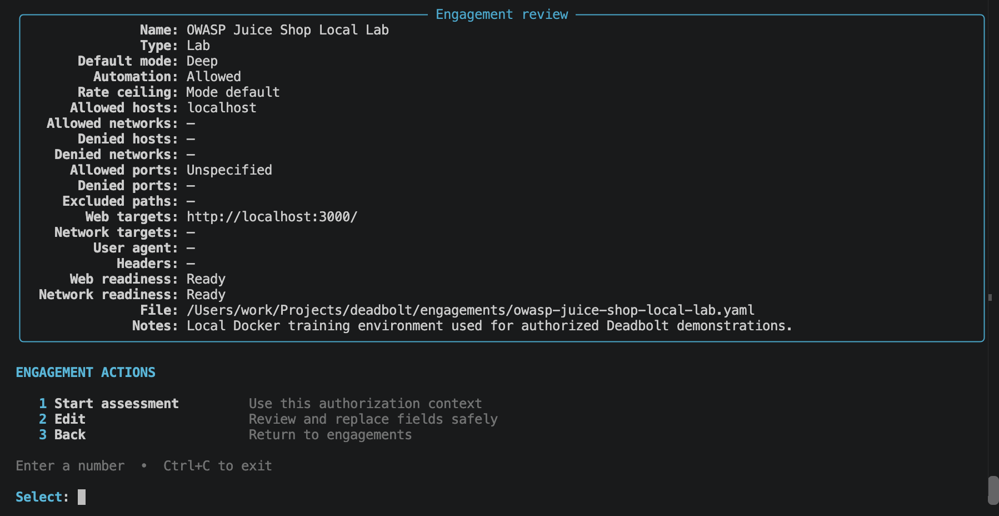
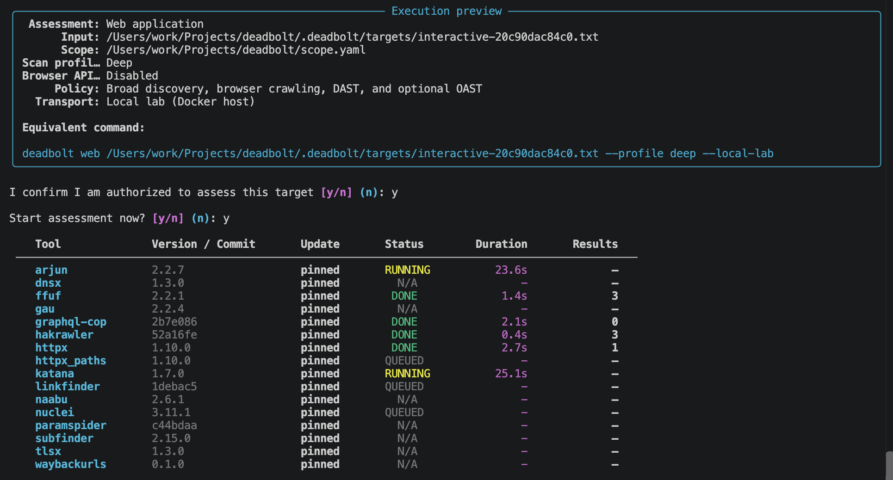
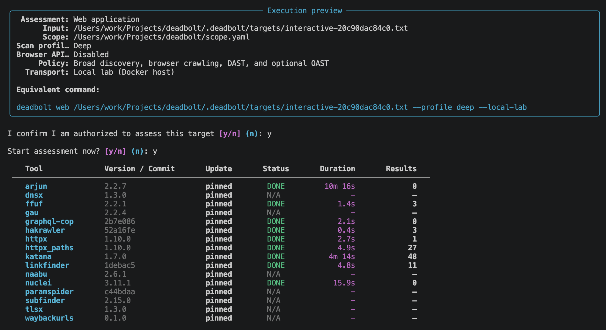
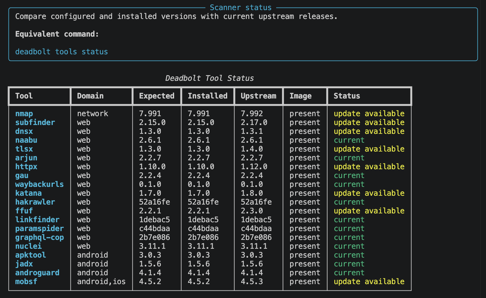

# 🔩 Deadbolt

**Deadbolt** is an engagement-aware security assessment orchestrator for
penetration testers, bug-bounty researchers, AppSec engineers, and security
teams. It coordinates focused scanners through reproducible pipelines, enforces
the declared authorization boundary, preserves evidence, resumes interrupted
work, and produces separate technical and stakeholder reports.

Deadbolt does not replace analyst judgement. A route is not automatically a
vulnerability, an open port is not automatically a finding, and scanner output
must be reproduced before it is reported.

> [!IMPORTANT]
> Run Deadbolt only against systems you are explicitly authorized to assess.
> Tool readiness does not grant authorization.



## Why Deadbolt

- Guided Mode teaches each workflow and shows the equivalent CLI command.
- Hard scope enforcement rejects unauthorized targets before execution and
  filters discovered assets before downstream scanners receive them.
- Saved engagements keep scope, reusable targets, traffic policy, and the
  operating mode together.
- Explicit artifact flow makes scanner inputs and outputs auditable.
- Resume restores verified work using hashes and execution fingerprints.
- Pinned Docker images isolate scanners and make builds reproducible.
- Raw evidence, normalized data, limitations, and reports remain traceable.
- Web, Network, Android, and iOS assessments share one interface.

Deadbolt is not a one-click exploitation framework, brute-force platform, or
substitute for written authorization and manual validation.

## Assessment lifecycle

```text
Authorization → Preview → Discovery → Enumeration → Validation
              → Vulnerability analysis → Manual validation → Reporting
```

## Requirements and installation

- Python 3.10+
- Docker Desktop or a compatible Docker daemon
- Git

```bash
git clone https://github.com/rdSoftInc/deadbolt.git
cd deadbolt
python -m venv .venv
source .venv/bin/activate
python -m pip install --upgrade pip
python -m pip install -e .

deadbolt --version
deadbolt tools build --parallel 3
deadbolt tools doctor
deadbolt tools status --offline
```

The first build can take time because each scanner is isolated in its own
image. MobSF is pulled from its official image rather than built locally.

## Guided Mode

```bash
deadbolt
```

The main menu provides:

1. **Start an assessment** — Web, Network, Android, or iOS
2. **Previous assessments** — inspect or resume eligible runs
3. **Scanner tools** — status, build, upgrade, rollback, and cleanup
4. **Reports** — open or regenerate preserved reports
5. **Environment health** — readiness, versions, and providers
6. **Engagements and scope** — create, edit, validate, review, or launch
7. **Exit**

Before sending traffic or changing scanner state, Guided Mode shows an
execution preview and the equivalent direct command.



## Engagements and scope

Engagements represent bug-bounty, client, internal, or lab authorization. They
store:

- Safe, Standard, or Deep mode
- Allowed and denied hosts, networks, and ports
- Excluded URL paths
- Automation permission and request-rate ceiling
- Required user-agent or header policy
- Reusable Web and Network targets
- Private notes

Create one from **Guided Mode → Engagements and scope**, or follow
[`engagements/example.yaml`](engagements/example.yaml). Saved targets are
validated against scope. Each run receives an immutable scope snapshot, so a
later edit cannot rewrite its historical authorization record.

Scope is fail-closed. Exact hosts do not imply subdomains; use an explicit
`*.example.com` rule. Denies win over allows. Network ranges must be fully
contained by allowed CIDRs and must not overlap denied CIDRs. Unknown and
out-of-scope discoveries remain evidence-only and are never actively scanned.

Legacy Web runs may use a workspace `scope.yaml`:

```yaml
allow:
  - example.com
  - '*.example.com'
deny:
  - admin.example.com
```



## Web assessments

```text
targets → assets → services → paths and APIs → findings
```

Deadbolt normalizes, deduplicates, validates, and scope-checks data between
tools instead of blindly piping raw output forward.

| Profile | Intended use | Policy |
|---|---|---|
| Safe | Bug bounty and sensitive production | Low traffic; no port scan, brute force, DAST, or OAST |
| Standard | Authorized daily-driver work | Balanced discovery, crawling, validation, and checks |
| Deep | Labs or explicitly broad authorization | Wider services, browser crawling, longer timeouts, DAST/OAST |

Profiles change scanner behavior, never authorization. Browser-assisted API
capture can be enabled independently of Deep mode. A rate ceiling caps
rate-aware scanners and serializes enumeration so parallel tools do not
multiply the intended traffic.

```bash
deadbolt web targets/web/program.txt --profile safe --rate-limit 1
deadbolt web targets/web/program.txt --profile safe --browser-assisted --rate-limit 1
deadbolt web targets/web/program.txt --profile standard
deadbolt web targets/web/lab.txt --profile deep
deadbolt web outputs/RUN_ID/work/input.targets.txt --resume-from outputs/RUN_ID
```

### Web coverage

| Stage | Tools and analysis |
|---|---|
| Discovery | Subfinder, DNSx, Naabu, TLSx, HTTPx |
| Enumeration | GAU, Waybackurls, Katana, Hakrawler, ffuf, ParamSpider, GraphQL Cop |
| API and inputs | LinkFinder, JavaScript reconstruction, Arjun, browser Fetch/XHR |
| Validation | HTTPx path validation and response enrichment |
| Vulnerabilities | Nuclei |

Safe and local-lab policies mark deliberately skipped tools as `N/A`.





### API intelligence

Deadbolt conservatively reconstructs supported direct and wrapped `fetch`,
Axios, and `XMLHttpRequest` calls. It can retain resolved origins, methods,
static header names, credentials mode, query/path/body field names, structural
types, wrapper chains, selected response fields, and nearby validation clues.

The canonical API inventory distinguishes:

- **Observed / High** — captured from browser traffic
- **Inferred / Medium** — deterministically reconstructed from JavaScript
- **Discovered / Low** — a route without complete semantics

Observed traffic is authoritative; static evidence may enrich it. Conflicts
remain visible. CORS preflights are paired with their application requests.
Cookies, tokens, header values, body values, and response values are omitted.

The report groups equivalent routes, records provenance and scope, and suggests
manual review families such as IDOR/BOLA, traversal, SSRF, file handling, and
open redirect. Suggestions are not vulnerability findings.

### Local Web lab

```bash
docker run --rm -d --name juice-shop -p 3000:3000 bkimminich/juice-shop
printf 'http://localhost:3000/#/\n' > targets/web/juice-shop.txt
deadbolt web targets/web/juice-shop.txt --local-lab --profile deep
```

Deadbolt verifies host and Docker reachability, preserves the non-standard port,
and maps loopback to Docker's host gateway. Public DNS/archive tools become
`N/A`; applicable local HTTP analysis remains enabled.

## Network assessments

Network runs require a saved engagement. Inspect a scope-bound plan without
sending packets, execute it, or resume verified phases:

```bash
deadbolt network targets/network/internal.txt --engagement engagements/internal.yaml --mode safe --plan-only
deadbolt network targets/network/internal.txt --engagement engagements/internal.yaml --mode safe
deadbolt network outputs/RUN_ID/work/input.network-targets.txt \
  --engagement engagements/internal.yaml --resume-from outputs/RUN_ID
```

Targets accept one IP, CIDR, or hostname per line; URLs and `host:port` values
are rejected.

| Mode | Current bounded policy |
|---|---|
| Safe | Top 100 TCP ports, connect scan, `-T2`, no NSE, max 10 packets/sec |
| Standard | Top 1000 TCP ports, light service detection, curated scripts, `-T3`, max 100 packets/sec |
| Deep | Full TCP SYN/service/OS, top-100 UDP, broader curated scripts, max 500 packets/sec |

The lower engagement rate always wins. Nmap vulnerability, intrusive,
brute-force, and denial-of-service script categories are not enabled. Reports
separate inventory and exposure review from explicit security findings, and a
quality gate validates scope and evidence consistency before finalization.

## Mobile assessments

```bash
deadbolt android targets/android/AndroGoat.apk
deadbolt ios targets/ios/app.ipa
```

Android combines Apktool resources/manifest analysis, Androguard semantic
metadata, JADX decompiled-code inspection, and MobSF correlation. iOS currently
uses MobSF static analysis. Both commands accept `--output DIRECTORY`.

Deadbolt starts MobSF when required, reuses a compatible local container,
discovers its local API key, and waits for readiness. Pull it separately with:

```bash
deadbolt tools build --tool mobsf
```

## Reports

- `technical-report.html` contains evidence, attack surface, API inventory,
  tools, scope, coverage, limitations, and analyst handoff.
- `stakeholder-report.html` provides concise risk context, priorities, metrics,
  and next actions without raw scanner noise.
- `report.html` remains a compatibility alias for the technical report.

```bash
deadbolt reports open outputs/RUN_ID --audience technical
deadbolt reports open outputs/RUN_ID --audience stakeholder
deadbolt reports generate outputs/RUN_ID
```

Regeneration uses preserved normalized evidence and does not rerun scanners.

[View the complete sample technical report (PDF)](docs/sample-reports/technical-report.pdf)

[View the complete sample stakeholder report (PDF)](docs/sample-reports/stakeholder-report.pdf)

## Scanner lifecycle

`main/config/tools.yaml` is the source of truth for image names, pins,
repositories, Dockerfiles, domains, and version detection.

```bash
# Readiness and versions
deadbolt tools doctor
deadbolt tools status
deadbolt tools status --offline
deadbolt tools providers

# Build or repair manifest pins
deadbolt tools build --parallel 3
deadbolt tools build --outdated
deadbolt tools build --tool httpx --tool nuclei

# Guarded upgrade
deadbolt tools upgrade plan
deadbolt tools upgrade test --tool httpx
deadbolt tools upgrade promote --tool httpx
deadbolt tools upgrade rollback --tool httpx

# Deadbolt-owned cleanup (dry run, then apply)
deadbolt tools cleanup
deadbolt tools cleanup --apply
```

An upgrade candidate cannot replace the active image until it builds and
verifies. Promotion preserves a rollback image and updates the manifest pin.
Cleanup never runs a global Docker prune or removes unrelated images.



## Optional providers

```bash
cp .env.example .env
deadbolt tools providers
deadbolt tools doctor
```

Slots exist for Shodan, Censys, SecurityTrails, VirusTotal, Chaos,
ProjectDiscovery, and private Interactsh. Private Interactsh is consumed by
Nuclei; the remaining entries are readiness placeholders until adapters exist.
Diagnostics never print credential values.

## Resume behavior

A completed tool is cached only when its input hash, execution fingerprint,
normalized output, and required work artifact still match. Resume restores
original durations and counts, reruns interrupted or invalidated work, and
preserves the original profile, local-lab flag, browser setting, rate ceiling,
and scope snapshot. Completed runs remain reviewable but are not offered as
resumable work.

## Output structure

```text
outputs/run_YYYYMMDD_HHMMSS/
├── meta.json
├── state.json
├── report.html
├── technical-report.html
├── stakeholder-report.html
├── scope/
├── logs/
├── raw/
├── work/
└── normalized/
```

Treat the whole run directory as confidential. `raw/` preserves original
evidence, `normalized/` contains canonical records, `work/` holds dependency
artifacts, and state/metadata make the run auditable and resumable.

## Privacy and repository safety

Git ignores reports, runtime state, real engagements, target lists, captures,
`.env`, common key formats, client data, and evidence directories by default.
Always inspect `git status` before committing; ignore rules cannot remove a
secret already committed to history. See [`SECURITY.md`](SECURITY.md) for
private vulnerability reporting.

## Known limitations

- Most optional provider variables do not yet have active adapters.
- Web launch blocks policies that cannot be enforced consistently by every
  relevant scanner, including unsupported header/path combinations.
- Repository-local ffuf wordlists are intentionally small and deterministic.
- Static JavaScript analysis cannot resolve arbitrary runtime behavior.
- iOS coverage is currently centered on MobSF static analysis.
- Automated results require manual reproduction and impact validation.

## Development

```bash
python -m pip install -e '.[test]'
pytest -q
```

The suite covers scope, engagements, Guided Mode, scanner lifecycle, resume,
reports, Web orchestration, API evidence, JavaScript reconstruction, local
labs, network planning/parsing, and tool compatibility.

## Principles

1. Authorization before execution
2. Scope safety before coverage
3. Evidence before conclusions
4. Reproducibility before convenience
5. Clear limitations over false confidence
6. Human validation before reporting

## License

Deadbolt is released under the [MIT License](LICENSE).

© 2026 Rolstan Robert D'souza
